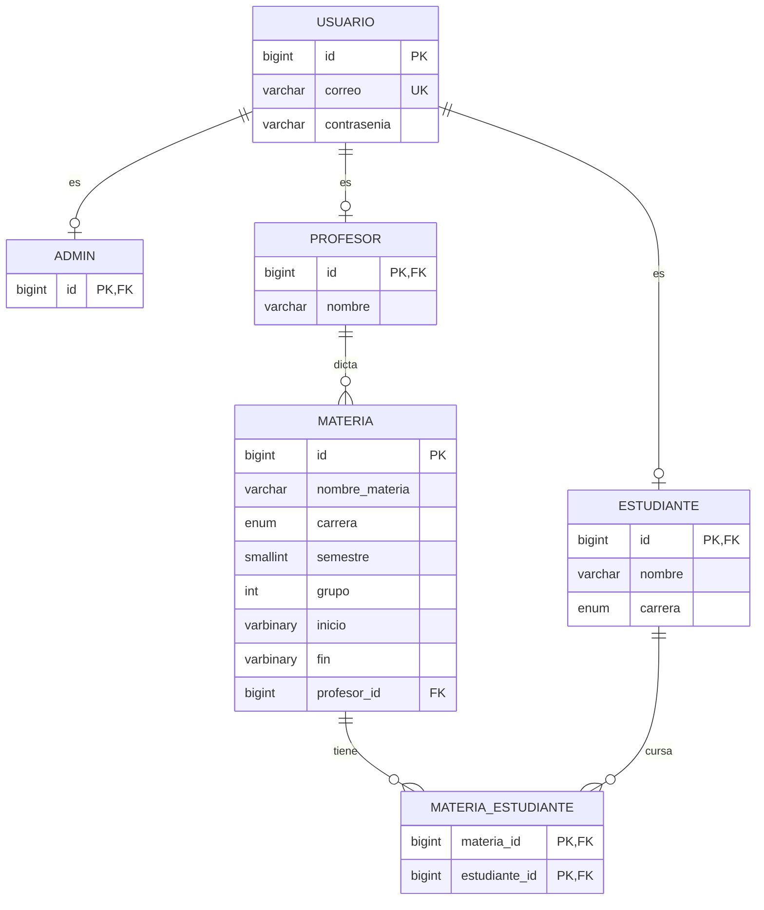

# Sistema de Horarios con Drag and Drop

Aplicación web para gestionar horarios académicos. Los **estudiantes** arman su horario arrastrando las secciones (materia + grupo) hasta una grilla semanal; los **profesores** consultan sus materias, grupos y estudiantes; y el **administrador** gestiona usuarios, materias, profesores asignados y reubicaciones de estudiantes entre grupos.

El sistema valida automáticamente los cruces de horario, tanto para estudiantes como para profesores.

---

## Tabla de contenidos

1. [Tecnologías](#tecnologías)
2. [Estructura del repositorio](#estructura-del-repositorio)
3. [Cómo ejecutarlo](#cómo-ejecutarlo)
4. [Roles y permisos](#roles-y-permisos)
5. [Arquitectura del back](#arquitectura-del-back)
6. [Autenticación (JWT)](#autenticación-jwt)
7. [Endpoints de la API](#endpoints-de-la-api)
8. [Modelo de datos](#modelo-de-datos)
9. [Reglas de negocio y validaciones](#reglas-de-negocio-y-validaciones)
10. [Arquitectura del front](#arquitectura-del-front)
11. [Configuración (`application.properties`)](#configuración-applicationproperties)
12. [Flujo de trabajo con Git](#flujo-de-trabajo-con-git)
13. [Integrantes](#integrantes)
14. [Licencia](#licencia)

---

## Tecnologías

| Capa | Tecnología |
|------|------------|
| **Back** (`sistemahorario`) | Java 17, Spring Boot 3.2.5, Maven (con wrapper), Spring Web, Spring Data JPA (Hibernate), Spring Security |
| Autenticación | JWT con `jjwt` 0.11.5 (firma HS256), contraseñas con BCrypt |
| Documentación de la API | springdoc-openapi 2.2.0 (Swagger UI) |
| Mapeo de objetos | ModelMapper 3.1.1 |
| Empaquetado | WAR (`ServletInitializer`) |
| **Front** (`frontSistemaHorario`) | Angular 22 (componentes standalone), TypeScript, RxJS, Angular CDK, Font Awesome 6 |
| Pruebas del front | Vitest + jsdom |
| **Base de datos** | MySQL (servicio online en Aiven, compartido por el equipo) |

---

## Estructura del repositorio

```
drag-and-drop-horariopn1/
├── sistemahorario/              # Back-end (API REST, puerto 8080)
│   ├── src/main/java/co/edu/unbosque/sistemahorario/
│   ├── src/main/resources/application.properties
│   ├── base_de_datos.sql        # Crea tablas y el admin inicial
│   ├── materias_ejemplo.sql     # Ejemplo para crear materias desde Workbench
│   ├── migracion_grupos_carrera.sql
│   └── pom.xml
├── frontSistemaHorario/         # Front-end Angular (puerto 4200)
│   └── src/app/
├── GUIA_EQUIPO.md               # Guía para correr el proyecto con la base compartida
├── LICENSE                      # MIT
└── README.md
```

### Scripts SQL

| Script | Para qué sirve |
|--------|----------------|
| `base_de_datos.sql` | Crea las tablas y el administrador inicial. **Se corre una sola vez** y la base compartida ya lo tiene, así que no hay que volver a ejecutarlo. |
| `materias_ejemplo.sql` | Plantilla para insertar materias directamente en la base (explica cómo se guardan `inicio` y `fin`, que son `int[]` serializados en binario). |
| `migracion_grupos_carrera.sql` | Agrega la columna `grupo` a `materia` y `carrera` a `estudiante` en bases creadas antes de ese cambio. Una base nueva no lo necesita. |

---

## Cómo ejecutarlo

La guía paso a paso (requisitos, base de datos compartida, Workbench, errores comunes) está en **[GUIA_EQUIPO.md](GUIA_EQUIPO.md)**. Resumen:

**Requisitos:** JDK 17, Eclipse o Spring Tools, Node.js LTS y Git.

**Back** (puerto 8080): abrir `sistemahorario` en Eclipse → clic derecho → *Run As → Spring Boot App*, o desde la terminal:

```bash
cd sistemahorario
./mvnw spring-boot:run
```

**Front** (puerto 4200):

```bash
cd frontSistemaHorario
npm install        # solo la primera vez
npx ng serve
```

Luego abrir <http://localhost:4200>.

**Swagger UI:** <http://localhost:8080/swagger-ui.html>

> El front tiene la URL del back escrita directamente (`http://localhost:8080`) en los servicios de `src/app/services/`, y el back solo acepta peticiones CORS desde `http://localhost:4200`. Por eso cada persona corre ambos en su propio equipo.

---

## Roles y permisos

| Rol | Qué puede hacer |
|-----|-----------------|
| **ADMIN** | Crear, editar y eliminar usuarios (estudiantes, profesores y administradores) y materias; asignar profesor a una materia; inscribir o desinscribir a cualquier estudiante; mover estudiantes entre grupos de la misma materia. |
| **PROFESOR** | Ver su horario y sus materias con los grupos y estudiantes inscritos. Puede consultar materias, profesores y estudiantes. |
| **ESTUDIANTE** | Armar su horario con drag and drop e inscribir o desinscribir **solo sus propias materias**. Puede consultar materias y profesores. |

---

## Arquitectura del back

Paquete base: `co.edu.unbosque.sistemahorario`

| Paquete | Contenido |
|---------|-----------|
| `controller` | `AuthController`, `AdminController`, `EstudianteController`, `ProfesorController`, `MateriaController` |
| `service` | Lógica de negocio: `AdminService`, `EstudianteService`, `ProfesorService`, `MateriaService` y `UserDetailsServiceImpl` (carga de usuarios y roles para Spring Security). `CRUDOPeration` es la interfaz común de los CRUD. |
| `repository` | Interfaces JPA: `AdminRepository`, `EstudianteRepository`, `ProfesorRepository`, `MateriaRepository` |
| `entity` | Entidades JPA: `Usuario` (abstracta), `Admin`, `Profesor`, `Estudiante`, `Materia` |
| `dto` | Objetos de transferencia: `AdminDTO`, `EstudianteDTO`, `ProfesorDTO`, `MateriaDTO`, `UsuarioDTO`, `AuthResponse` |
| `security` | `SecurityConfig` (reglas de acceso), `JwtRequestFilter` (valida el token en cada petición), `CorsConfig`, `OpenApiConfig` |
| `util` | `JwtUtil` (genera y valida tokens), `enums/Carrera` y `exceptions/` (excepciones de validación y `LanzadorDeExcepcion`, con las reglas de formato y horario) |

Flujo típico de una petición: `controller` → `service` → `repository` → base de datos. Los servicios devuelven un **código entero** (0 = éxito y otros valores para cada error) y el controlador lo traduce a un estado HTTP con su mensaje.

---

## Autenticación (JWT)

1. El cliente llama a `POST /api/auth/login` con `correo` y `contrasenia`.
2. Si son correctos, el back responde con un `AuthResponse`: `id`, `token`, `rol`, `nombre` y `correo`.
3. En las siguientes peticiones el cliente envía el token en la cabecera:

   ```
   Authorization: Bearer <token>
   ```

4. La sesión es **stateless** (sin `HttpSession`) y CSRF está deshabilitado porque se usa JWT.
5. Sin token o con token vencido, el back responde **401**.

En el front, `AuthService` guarda el token y los datos del usuario en `localStorage`, el `authInterceptor` agrega la cabecera `Authorization` a cada petición y los *guards* (`role.guard.ts`) protegen las rutas por rol.

### Probar con Swagger

1. Abrir <http://localhost:8080/swagger-ui.html>.
2. Ejecutar `POST /api/auth/login` y copiar el token de la respuesta.
3. Pulsar **Authorize**, pegar el token y probar los demás endpoints.

---

## Endpoints de la API

Todos los parámetros se envían como **parámetros de la petición** (`@RequestParam`, es decir, query string o formulario), no como cuerpo JSON.

### Acceso según `SecurityConfig`

| Ruta | Quién puede acceder |
|------|---------------------|
| `/api/auth/**`, `/swagger-ui/**`, `/v3/api-docs/**`, `/error` | Público |
| `GET /materia/mostrartodo`, `GET /profesor/mostrartodo` | Cualquier usuario autenticado |
| `GET /estudiante/mostrartodo` | ADMIN, PROFESOR |
| `PUT /materia/inscribirestudiante`, `PUT /materia/desinscribirestudiante` | ADMIN, ESTUDIANTE (el estudiante solo sobre sí mismo) |
| Cualquier otra ruta de `/admin`, `/estudiante`, `/profesor`, `/materia` | Solo ADMIN |

### Autenticación — `/api/auth`

| Método | Ruta | Parámetros | Descripción |
|--------|------|------------|-------------|
| POST | `/api/auth/login` | `correo`, `contrasenia` | Devuelve el token JWT y los datos del usuario. **401** si las credenciales son incorrectas. |

### Administradores — `/admin`

| Método | Ruta | Parámetros | Descripción |
|--------|------|------------|-------------|
| POST | `/admin/crear` | `correo`, `contrasenia` | Crea un administrador. |
| GET | `/admin/mostrartodo` | — | Lista los administradores. |
| PUT | `/admin/actualizar` | `id`, `correo`, `contrasenia` (opcional) | Actualiza un administrador. |
| DELETE | `/admin/eliminar` | `id` | Elimina un administrador. |

### Estudiantes — `/estudiante`

| Método | Ruta | Parámetros | Descripción |
|--------|------|------------|-------------|
| POST | `/estudiante/crear` | `nombre`, `correo`, `contrasenia`, `carrera` | Crea un estudiante. |
| GET | `/estudiante/mostrartodo` | — | Lista los estudiantes. |
| PUT | `/estudiante/actualizar` | `id`, `nombre`, `correo`, `carrera`, `contrasenia` (opcional) | Actualiza un estudiante. |
| DELETE | `/estudiante/eliminar` | `id` | Elimina un estudiante. |

### Profesores — `/profesor`

| Método | Ruta | Parámetros | Descripción |
|--------|------|------------|-------------|
| POST | `/profesor/crear` | `nombre`, `correo`, `contrasenia` | Crea un profesor. |
| GET | `/profesor/mostrartodo` | — | Lista los profesores. |
| PUT | `/profesor/actualizar` | `id`, `nombre`, `correo`, `contrasenia` (opcional) | Actualiza un profesor. |
| DELETE | `/profesor/eliminar` | `id` | Elimina un profesor. |

### Materias — `/materia`

| Método | Ruta | Parámetros | Descripción |
|--------|------|------------|-------------|
| POST | `/materia/crear` | `nombreMateria`, `carrera`, `semestre`, `inicio[]`, `fin[]`, `grupo` (por defecto 1) | Crea una materia (un grupo de una materia). |
| GET | `/materia/mostrartodo` | — | Lista las materias. |
| PUT | `/materia/actualizar` | `id` + los mismos parámetros de `crear` | Actualiza una materia. |
| DELETE | `/materia/eliminar` | `id` | Elimina una materia. |
| PUT | `/materia/asignarprofesor` | `idProfesor`, `idMateria` | Asigna un profesor a la materia. |
| PUT | `/materia/inscribirestudiante` | `idEstudiante`, `idMateria` | Inscribe un estudiante en la materia. |
| PUT | `/materia/desinscribirestudiante` | `idEstudiante`, `idMateria` | Quita la inscripción. |
| PUT | `/materia/moverestudiante` | `idEstudiante`, `idMateriaOrigen`, `idMateriaDestino` | Mueve un estudiante a otro grupo de la misma materia. |

Respuestas de inscripción, desinscripción y movimiento:

| Operación | Código | Significado |
|-----------|--------|-------------|
| Inscribir | 202 | Estudiante inscrito con éxito. |
| | 409 | Ya está inscrito en esa materia, ya está inscrito en otro grupo de la misma materia, o el horario se cruza con otra materia suya. |
| | 403 | Un estudiante intentó modificar el horario de otro. |
| | 404 | No se encontró el estudiante o la materia. |
| Desinscribir | 200 / 409 / 404 | Éxito / no estaba inscrito / no se encontró. |
| Mover | 200 | Estudiante movido con éxito. |
| | 409 | No está en el origen, los grupos no son de la misma materia, ya está en el destino, o el destino se cruza con otra materia suya. |
| Asignar profesor | — | Falla si la materia ya tiene profesor o si choca con el horario del profesor. |

> Los endpoints `POST /admin/iniciarsesion`, `/estudiante/iniciarsesion` y `/profesor/iniciarsesion` existen en el código, pero el inicio de sesión real del sistema es `POST /api/auth/login`.

### Valores de `carrera`

`ING_SISTEMAS`, `ING_INDUSTRIAL`, `BIOING`, `ING_ROBOTICA`, `MEDICINA`, `PSICOLOGIA`, `MAT_CIENCIA_DATOS`, `ESTADISTICA`, `FISICA`

---

## Modelo de datos



- **Herencia:** `Usuario` es una entidad abstracta con estrategia `JOINED`. `Admin`, `Profesor` y `Estudiante` comparten el `id` de `usuario`.
- **Materia = un grupo.** Cada fila de `materia` es un grupo concreto. La combinación (`nombre_materia`, `grupo`) es única.
- **Horario:** `inicio` y `fin` son arreglos de 5 enteros (lunes a viernes) con la hora de inicio y de fin de cada día. El valor **`-1`** significa que no hay clase ese día.
- **Inscripciones:** relación muchos a muchos entre materia y estudiante en la tabla `materia_estudiante`.
- `spring.jpa.hibernate.ddl-auto=validate`: Hibernate **no crea ni modifica tablas**, solo verifica que coincidan con las entidades. Los cambios de esquema se hacen con scripts SQL.

---

## Reglas de negocio y validaciones

**Horario de una materia** (`LanzadorDeExcepcion.verificarFranjaHoraria`):

- La hora de fin debe ser mayor que la de inicio.
- Máximo **4 horas por día**.
- Las clases son de **7 a 13** o de **14 a 22**: no pueden cruzar la hora de almuerzo (13 a 14).

**Cruces de horario:** no se puede inscribir un estudiante ni asignar un profesor si la materia se cruza con otra que ya tenga.

**Un grupo por materia:** un estudiante no puede estar inscrito en dos grupos de la misma materia.

**Formato de datos:**

| Campo | Regla |
|-------|-------|
| Nombre de persona | Mínimo 2 caracteres; solo letras, espacios, tildes y ñ. |
| Nombre de materia | Solo letras, números y espacios. |
| Correo | Con formato válido y dominio `unbosque.edu.co` o `gmail.com`. |
| Contraseña | Mínimo 8 caracteres, con letras, números y símbolos. Se guarda cifrada con BCrypt. |
| Correo repetido | No se permite: el correo es único en todo el sistema. |

---

## Arquitectura del front

Aplicación Angular con componentes standalone. Ruta base: `frontSistemaHorario/src/app`.

| Carpeta | Contenido |
|---------|-----------|
| `login/` | Pantalla de inicio de sesión. |
| `vista-estudiante/` | `sidebar-secciones` (secciones disponibles, arrastrables), `cronograma-horario` (grilla donde se sueltan) y `horario-inscrito`. |
| `vista-profesor/` | `cronograma-profesor` y `materias-grupos` (materias, grupos y estudiantes). |
| `vista-admin/` | `dashboard-admin`, `materias-admin`, `registro-usuarios` y `reubicaciones-admin`. |
| `shared/topbar/` | Barra superior con pestañas, común a las tres vistas. |
| `services/` | Comunicación con el back: `auth`, `admin`, `estudiante`, `profesor`, `materia` y `horario`. |
| `guards/` | `role.guard.ts`: `estudianteGuard`, `profesorGuard` y `adminGuard`. |
| `interceptors/` | `auth.interceptor.ts`: agrega el token y cierra la sesión si el back responde 401. |
| `models/` | Interfaces y enums (`Role`, `Carrera`, materia, sección, usuario, validación). |

### Rutas

| Ruta | Vista | Protegida por |
|------|-------|---------------|
| `/login` | Inicio de sesión | — |
| `/estudiante` | Vista del estudiante | `estudianteGuard` |
| `/profesor` | Vista del profesor | `profesorGuard` |
| `/admin` | Vista del administrador | `adminGuard` |

La ruta vacía y cualquier ruta desconocida redirigen a `/login`.

### Pestañas por rol

| Rol | Pestañas |
|-----|----------|
| Estudiante | Armar horario · Mi horario inscrito |
| Profesor | Mi horario · Mis materias y grupos |
| Admin | Panel · Materias · Registrar usuario · Reubicaciones |

### Drag and drop

Se implementa con el API nativo de HTML5: en `sidebar-secciones` cada sección es `draggable` y dispara `dragstart`; en `cronograma-horario` la grilla recibe el evento `drop`. Antes de ubicar una sección se valida el cruce con las demás (`HorarioService.validarChoque`), y al guardar se libera el horario anterior y se inscriben las nuevas secciones.

---

## Configuración (`application.properties`)

Ubicación: `sistemahorario/src/main/resources/application.properties`

| Propiedad | Para qué sirve |
|-----------|----------------|
| `spring.datasource.url` | URL JDBC de la base MySQL. |
| `spring.datasource.username` | Usuario de la base. |
| `spring.datasource.password` | Contraseña de la base. |
| `spring.jpa.hibernate.ddl-auto` | Debe quedar en `validate`. |
| `spring.jpa.show-sql` | Muestra las consultas SQL en consola. |
| `jwt.secret` | Clave con la que se firman los tokens. |
| `jwt.expiration` | Duración del token en milisegundos. |

> ⚠️ **Nunca subas contraseñas ni el `jwt.secret` al repositorio.** Cada integrante cambia solo `url`, `username` y `password` en su copia local y pide la contraseña por privado. Para que git no ofrezca subir ese archivo:
>
> ```bash
> git update-index --skip-worktree sistemahorario/src/main/resources/application.properties
> ```
>
> Más detalle en [GUIA_EQUIPO.md](GUIA_EQUIPO.md).

---

## Flujo de trabajo con Git

- **No se hace push directo a `main`.** `main` es la versión estable.
- `TestPreMain` es la rama de integración: allí se juntan los cambios antes de pasar a `main`.
- Cada integrante trabaja en su propia rama creada a partir de `TestPreMain`, y sus cambios entran mediante **Pull Request** hacia `TestPreMain`.
- Al final, cuando todo funciona, el equipo une `TestPreMain` con `main`.

---

## Integrantes

- Santiago Soto Cartagena
- Nicolás Barreto Arroyo
- José Manuel Cipagauta
- María Angélica Caiza Eraso
- Jean Paul Quintero Peláez

---

## Licencia

Distribuido bajo la licencia MIT. Consulta el archivo [LICENSE](LICENSE).
